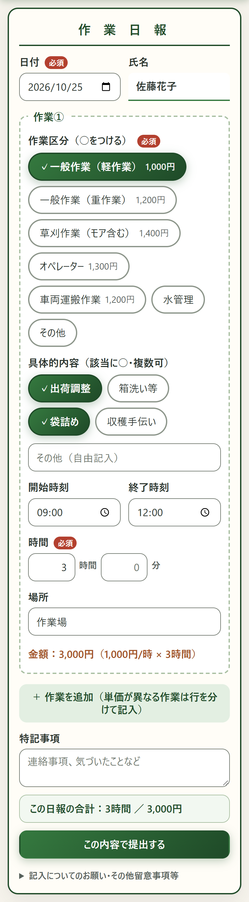
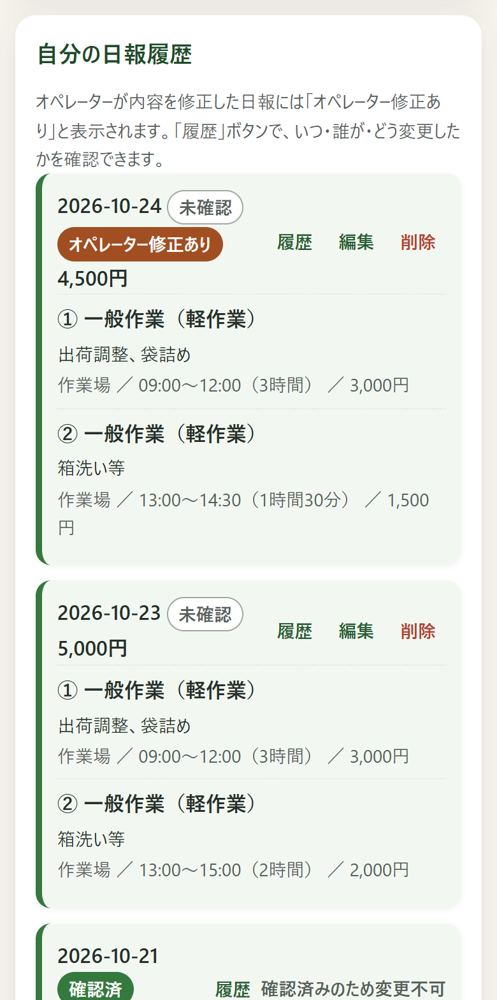
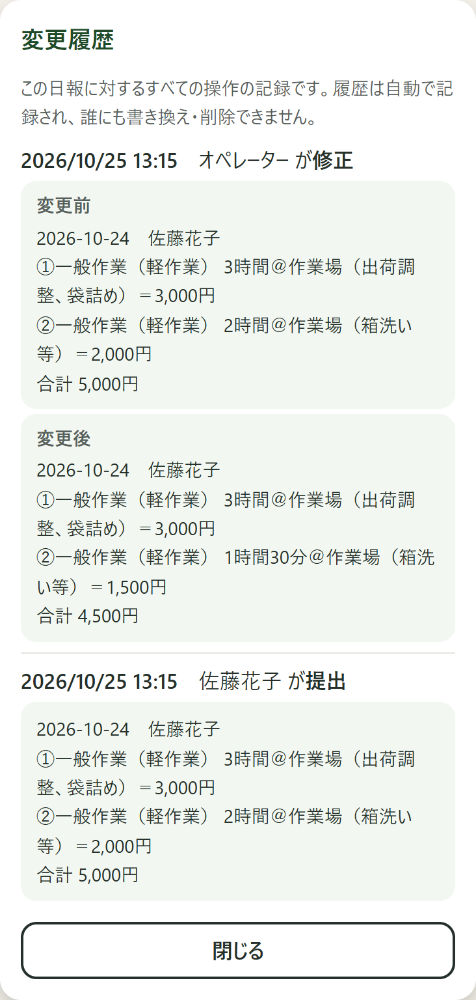
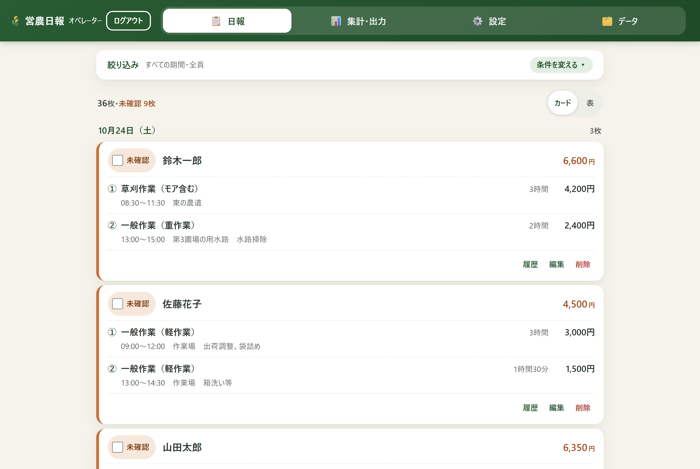
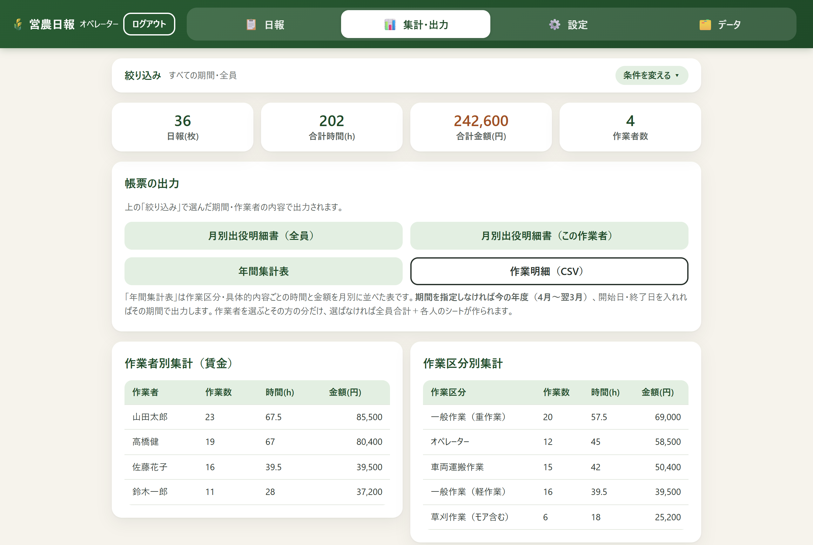
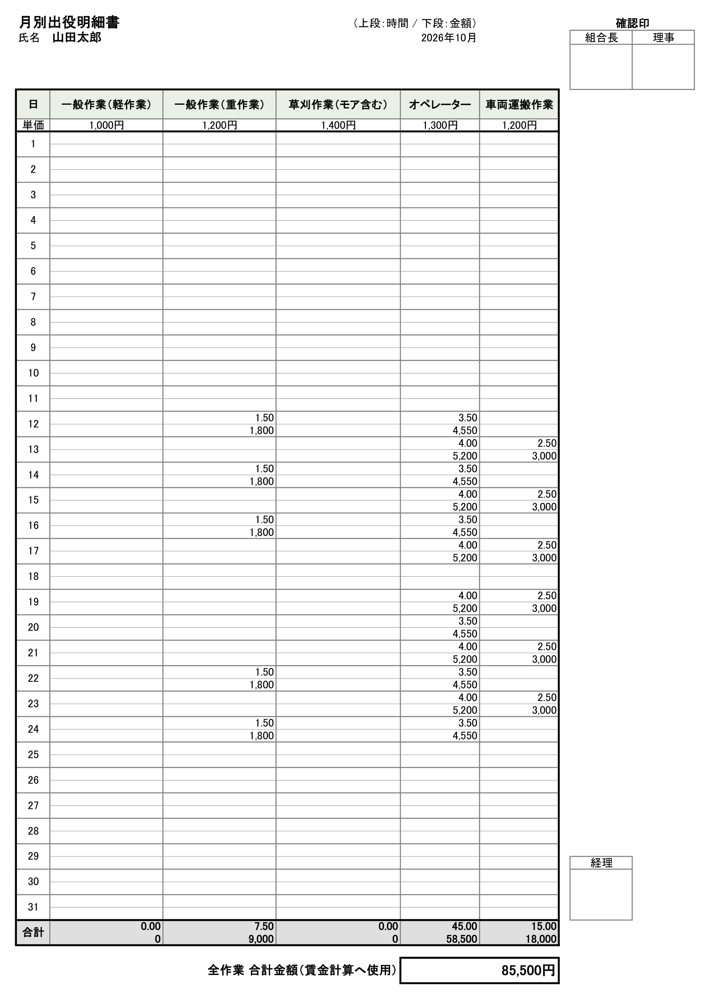

# 🌾 営農日報アプリ

紙のハガキで提出していた農作業の日報を、スマホから入力できるWebアプリにしました。作業者の入力から、事務担当（オペレーター）の確認、賃金の集計、Excelの明細書づくりまでを1つのアプリで行えます。営農組合で実際に運用しています。

> **このリポジトリについて**
>
> 実績紹介用の公開版です。運用中のシステムとは別に管理しており、単価と作業内容の選択肢はサンプル値に置き換えています。画面に写っている氏名・場所などのデータはすべて架空です。

<table>
  <tr>
    <td align="center" valign="top" width="33%"><br><sub>作業者の入力画面（スマホ）</sub></td>
    <td align="center" valign="top" width="33%"><br><sub>自分の日報履歴（修正の印つき）</sub></td>
    <td align="center" valign="top" width="33%"><br><sub>変更履歴（変更前と変更後）</sub></td>
  </tr>
</table>



## 解決したかったこと

紙の日報では、事務担当が紙を集め、作業区分ごとの「単価 × 時間」で賃金を計算して、月別の出役明細書に書き写していました。このアプリでは、作業者がスマホで入力した時点で金額が計算され、事務担当は確認と帳票の出力だけで済みます。

## 主な機能

### 作業者（スマホ）
- 紙のハガキと同じ並びで入力（作業区分に○、具体的内容に○、時間、場所）。氏名を入れるだけで使えます
- 作業ごとの金額と1日の合計を、提出前にその場で表示
- 提出前の確認画面で、内容全体を見直してから提出
- 自分の日報の閲覧・修正・削除（オペレーターが確認した日報は変更できません）
- ホーム画面に追加すると、アプリのように全画面で使えます（PWA）

### オペレーター（PC）
- 日付ごとのカードで日報を一覧表示。未確認の枚数がひと目でわかります
- 「確認」のチェックが紙の確認印にあたり、確認済みの日報は作業者から変更できなくなります
- 作業者別（賃金）と作業区分別の集計
- 帳票の出力
  - **月別出役明細書**（Excel）：紙の様式を罫線・列幅・確認印の欄まで再現
  - **年間集計表**（Excel）：作業区分と具体的内容ごとの時間・金額を月別に並べた表
  - **作業明細**（CSV、Excelでそのまま開けるBOM付きUTF-8）
- 日報提出の締め日の設定（締め日を過ぎた提出・修正には印が付きます）
- 作業区分・単価・選択肢の管理、バックアップと復元



<p align="center"><br><sub>出力した月別出役明細書（Excel）</sub></p>

## 工夫したところ

### 1. 紙に慣れた人が迷わない画面
紙の日報の並びと言葉づかいを、そのまま画面にしました（「作業区分に○をつける」など）。作業者はパスワードなしで、氏名だけで使えます。氏名に入ったスペースは自動で詰め、表記ゆれで別人扱いになるのを防いでいます。

### 2. 賃金の計算を間違えない
- 金額は「単価 × 分 ÷ 60」で1分単位に計算し、円未満は四捨五入
- 単価は、日報を登録した時点の値を作業ごとに記録します。あとで単価を改定しても過去の日報の金額は変わらず、月の途中で改定があった場合は明細書に両方の単価を併記します
- 600分のつもりで6000分と打つような桁違いの入力は、1日24時間を超えた時点で止めます

### 3. 紙と同じく、勝手に書き換えられない
- 提出・修正・削除・復元・確認のすべての操作を、変更前と変更後の内容つきで自動記録します。履歴を書き換えたり消したりする機能は、アプリのどこにもありません
- オペレーターが修正した日報には、作業者の画面に「オペレーター修正あり」と表示され、作業者自身が変更内容を確かめられます
- 削除した日報はごみ箱に残り、いつでも復元できます

### 4. データを失わない
- 毎日自動でバックアップ（直近14日は毎日分、それより前は月初の分を1年分）
- バックアップの一覧から1クリックで復元できます。復元の直前には、その時点の控えを自動で残します
- 保存処理は1列の順番待ちにして、同時に書き込んでも順序が入れ替わらないようにしています

### 5. インターネットに公開しても安全に
- 合言葉を設定すると、知らない人はAPIを一切使えません
- ログインと合言葉は、5回失敗すると10分ロック
- 入力の長さと件数に上限を設け、データの膨張を防止
- 日付はすべて日本時間で扱います（サーバーが海外のリージョンにあるため）

### 6. デザインシステムで見た目を統一
- 色・余白・文字の大きさなどを `public/tokens.css` の320個のトークンに集約しました（基本の値 → 意味 → 部品 の3層）。`DESIGN_SYSTEM.md` が画面の唯一の仕様です
- `npm run check:design` で、直書きの値・未定義のトークン・文字と背景のコントラスト（WCAG 2.2 AA、35組）を自動で検査します
- 入力欄の枠のコントラストを 1.12:1 から 4.24:1 に改善し、タップできる部分は44px以上にしました

## 運用で起きた問題と対策

運用を始めた翌朝、サーバーを再起動したときにデータファイルを読み込めず、プログラムが空のデータで上書きして、前日の日報が消える事故がありました。再発を防ぐために、次の3つを入れました。

- 読み込みに失敗したら、上書きせずに起動を止める
- 壊れたファイルは別の名前で退避する
- 毎日の自動バックアップと、画面からの復元

## 設計上の割り切り

- **作業者は氏名だけで識別します。** 紙の日報と同じ手軽さを優先しました。そのかわり、確認済みの日報は作業者から変更できず、すべての変更が履歴に残ります
- **データは1つのJSONとしてメモリに持ち、保存のたびに丸ごと書き込みます。** 1つの組合で使う規模なので、仕組みの単純さを優先しました。データベースを直接書き換えたときは、サーバーを再起動して読み込み直す必要があります

## 技術構成

| 役割 | 使ったもの |
|---|---|
| サーバー | Node.js、Express |
| 画面 | HTML / CSS / JavaScript（フレームワークなし）、PWA |
| 保存 | PostgreSQL（JSONB。本番は Neon）、ローカルでは JSON ファイル |
| 帳票 | ExcelJS |
| 公開 | Render（GitHub に push すると自動で反映） |

## 動かし方

Node.js 18 以上が必要です。

```bash
npm install
npm start
```

http://localhost:3000 を開きます。オペレーターのパスワードは、起動したときにコンソールに表示されます（固定するときは環境変数 `ADMIN_PASSWORD` を設定）。

デモデータ（架空の4人・約2週間分）を入れるときは、サーバーを起動したまま別のターミナルで次を実行します。

```bash
ADMIN_PASSWORD=<表示されたパスワード> npm run seed-demo
```

PowerShell の場合は `$env:ADMIN_PASSWORD = "<表示されたパスワード>"; npm run seed-demo` です。

| 環境変数 | 内容 |
|---|---|
| `ADMIN_PASSWORD` | オペレーターのパスワード（未設定なら起動のたびに自動で作成） |
| `DATABASE_URL` | PostgreSQL の接続文字列（未設定なら `data/db.json` に保存） |
| `SITE_CODE` | 合言葉（設定すると、知らない人はAPIを使えない） |
| `DATA_DIR` | JSON ファイルの保存先（既定は `data/`） |
| `PORT` | ポート番号（既定は 3000） |

## ファイル構成

```
├── server.js                    # API・集計・帳票の出力（Express）
├── public/
│   ├── index.html, app.js       # 画面（作業者・オペレーター）
│   ├── tokens.css, style.css    # デザイントークンと部品のスタイル
│   ├── help.html                # 使い方のページ
│   └── manifest.webmanifest, sw.js  # PWA
├── DESIGN_SYSTEM.md             # 画面の仕様
├── scripts/
│   ├── check-design-tokens.js   # デザインの自動検査
│   └── seed-demo.js             # デモデータの登録
└── docs/screenshots/            # この README の画像
```

## 開発体制

企画、現場の要望の取りまとめ、仕様の決定、本番環境（Render・Neon）の用意と日々の運用は本人が担当しました。実装は、AI コーディングアシスタント（Claude Code）と対話しながら進めています。
